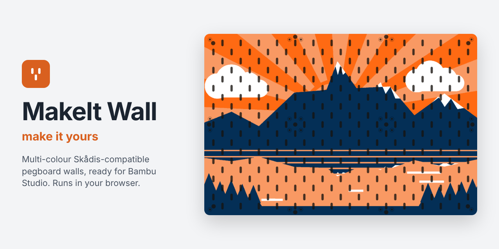
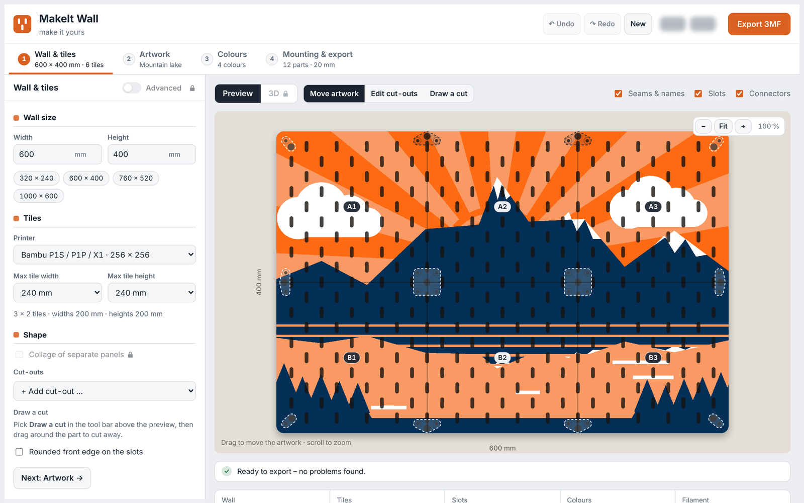
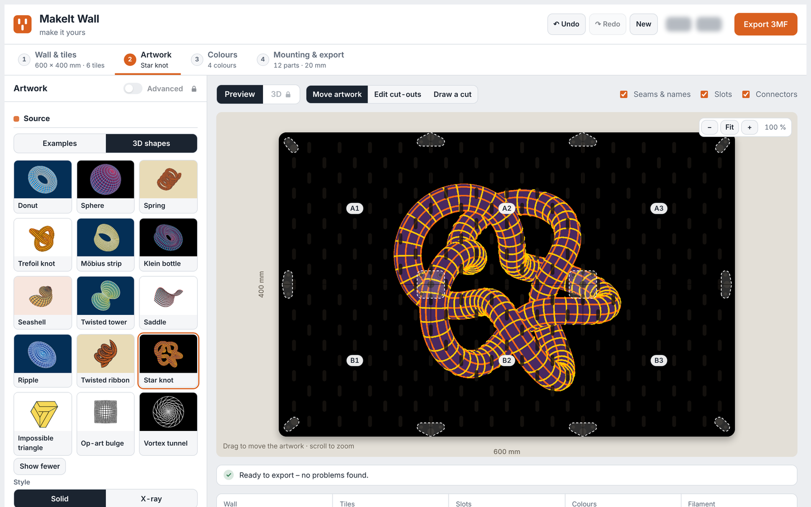
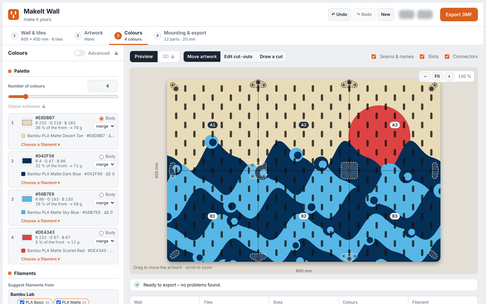

  

# MakeIt Wall – make it yours

**MakeIt Wall** turns a picture into a multi-colour pegboard wall for your 3D printer. It works with IKEA SKÅDIS accessories. Pick an artwork and set the wall size. The tool splits the wall into printable tiles and exports a **3MF for Bambu Studio** with every colour already assigned to a filament slot.

Everything runs in your browser. No account, no upload, no install.

**[▶ Open MakeIt Wall](https://flawlessFlow.github.io/makeit-wall/)** &nbsp;·&nbsp; [Download the latest version](../../releases/latest)

## Features

- **Any wall size** from 80 mm up to 4 m, split into tiles that fit your printer's bed. Seams stay on the 40 mm slot grid.
- **Real SKÅDIS slot grid.** Slots on the seams are split in half and become full slots once the tiles touch. A rounded front edge on the slots is optional.
- **15 drawn examples** (mountain lake, waves, night forest, 70s sun, city at night …) **and 15 3D wireframe shapes** (donut, Möbius strip, Klein bottle, star knot, impossible triangle …). Examples come with endless random variations.
- **Up to 16 colours.** Every colour becomes its own part and filament slot, matched to the closest **Bambu Lab PLA Basic / PLA Matte** colour.
- **Cut-outs** for doors, windows, sockets or furniture, plus free cuts you draw yourself.
- **Wall mounting:** printed connectors with M4 screws or snap pins, colour-matched cover caps, a choice of wall gap (11–25 mm). Or screw each tile to the wall on its own.
- **Colour & fit test.** A small test tile with your artwork in miniature, real-size slots and every hole type, so you can check colours and fit before printing the whole wall.
- **Assembly guide (PDF)** with the wall layout, the filament for each slot, the hardware list and the assembly steps.
- **Filament shopping list and print plan** with weight estimates and the filaments each tile needs.
- Undo / redo. Your work is saved automatically in your browser.

## How to use it

1. **Wall & tiles:** set the wall size and your printer, and add cut-outs if needed.
2. **Artwork:** choose an example or a 3D shape, then move, zoom and rotate it on the wall.
3. **Colours:** set the number of colours and pick the filament for each slot.
4. **Mounting & export:** choose connectors and wall gap, then click **Export 3MF**.

Open the tiles 3MF in Bambu Studio. It shows *"The 3mf file has invalid config, load geometry data only"*: click **OK**. Parts, colours and plates are kept, and print settings come from your own presets. Each tile is on its own plate.

## What you need

- A **Bambu Lab printer**, ideally with an AMS: A1 mini, A1, P1S / P1P, X1 or H2D. Any other bed size can be entered as a custom bed.
- **Bambu Studio** to slice the 3MF files.
- A current desktop browser (Chrome, Edge or Firefox) with an internet connection on first load. The page loads a few open-source libraries from jsDelivr.
- **Hardware** for the wall connectors: M4 countersunk screws and nuts (the length depends on the wall gap), plus wood screws and wall plugs. The tool lists the exact numbers for your wall.

## Printing tips

- 0.2 mm layers, smooth or textured PEI, outer brim, prime tower on.
- Tiles print **face down** and are mirrored for that, so the artwork reads correctly once you flip the tile.
- A tile only needs the filaments that appear on it, so a 4-slot AMS can print walls with more colours tile by tile.
- **Print the colour & fit test first.**

## Privacy

Your settings never leave your computer. MakeIt Wall has no server, no tracking and no cookies. The autosave lives in your browser's local storage, and **New** starts over with the default settings.

## Run it offline / locally

Download `index.html` (or the file attached to the [latest release](../../releases/latest)) and open it in your browser. The browser still needs internet access to load the libraries listed in [THIRD_PARTY_NOTICES.md](THIRD_PARTY_NOTICES.md).

## Feedback

Found a bug or a wall that does not export correctly? Please [open an issue](../../issues) with your browser, your printer and a screenshot of the settings.

## License

Copyright © 2026 Florian Mehner. All rights reserved.
MakeIt Wall is **free to use for private, non-commercial purposes**. Selling the software or anything made with it (files, printed tiles, walls), changing it or passing it on is not allowed. See [LICENSE](LICENSE) for the full terms. For commercial use, please ask through [Issues](../../issues).
Third-party libraries and data are listed in [THIRD_PARTY_NOTICES.md](THIRD_PARTY_NOTICES.md).

---

MakeIt Wall is an independent project and is not affiliated with, endorsed by or sponsored by IKEA or Bambu Lab. SKÅDIS is a trademark of Inter IKEA Systems B.V.; Bambu Lab, Bambu Studio and AMS are trademarks of Bambu Lab. They are used here only to describe compatibility.
